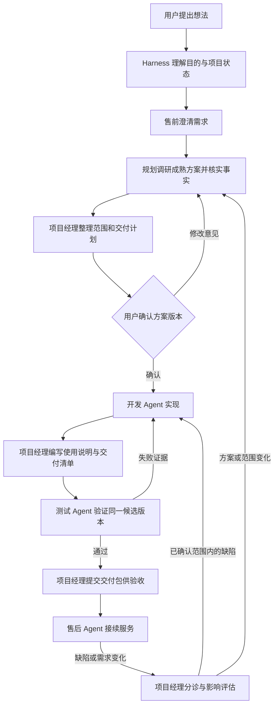

# ShallowSee Harness：许愿式编程

状态：2026-11-14 用户明确的产品方向，以及据此整理的目标架构。岗位职责、搜索范围和主交付流程来自用户要求；下面的状态机、数据结构与实施次序为实现设计，尚未全部实现。

本定义取代此前“Shelf Life 是唯一当前产品、通用 Harness 后置”的范围决定。Shelf Life 保留为已有的资料核查能力与历史演示，不再定义整个项目。

## 产品目标

用户提出想法，Harness 理解用户当前目的和项目状态，调度具有不同职责、模型和工具权限的 Agent，完成需求澄清、售前、规划、开发、项目管理、使用说明、测试和售后的软件生产流程。

用户提供目标、约束并确认方案。Harness 维护项目事实、安排交接、控制执行和成本；各岗位对自己的产物负责。已确认范围内的工作可以连续执行，只有信息不足、方案变更或超出既定约束时才需要用户决定。

## 岗位与产物

| 岗位 | 负责的决定与工作 | 主要产物 | 搜索 API |
| --- | --- | --- | --- |
| 售前 `presales` | 澄清使用者、业务问题、价值、范围、交付预期与可行性；识别关键未知条件 | 需求简报、可行性说明、待确认问题 | 可用 |
| 规划 `planner` | 搜索成熟工业方案，比较适用性、维护状态、实时事实与成本，形成架构和验收标准 | 版本化方案、方案比较、证据清单、验收用例 | 可用 |
| 项目经理 `project_manager` | 管理目标、范围、进度、依赖和变更；协调资料请求；开发后编写使用说明并组织交付 | 任务分解、交接包、进度报告、使用说明、交付清单 | 可用 |
| 开发 `developer` | 按确认方案使用编程 Agent 实现、运行开发检查并处理返工；发现方案问题时提出变更 | 代码、差异、运行入口、依赖与开发检查记录 | 不可用 |
| 测试 `tester` | 按独立验收用例验证指定版本及使用说明，报告缺陷、复现与实际执行结果 | 测试报告、失败证据、复测结果 | 不可用 |
| 售后 `support` | 解答已交付版本的使用问题，分诊故障和新需求，维护问题记录 | 使用答复、故障工单、需求变更请求 | 不可用 |

Harness 路由组件没有业务搜索权限。它选择工作流或候选岗位，不代替这些岗位完成工作。

## 主流程与返工

这是默认生产路径。中途消息按意图与状态进入相应岗位，无须每次从售前重新开始。售前和规划可在上下文充分时直接使用已有有效产物；不能省略方案确认、实际测试与版本绑定。

项目经理先接收开发交付并编写使用说明，再将候选版本和说明交测试岗。开发返工后，项目经理同步修改说明，测试岗针对新版本复测；旧版本的通过记录不能直接用于新版本。

## 根据当前目的调度

| 当前目的或事件 | 首要岗位 | Harness 的约束 |
| --- | --- | --- |
| 新想法、业务问题、可行性咨询 | 售前 | 复用已知需求，只补充影响方案的缺失条件 |
| 比较技术路线、设计架构、核实外部事实 | 规划 | 提供适用范围、实时来源与方案版本 |
| 询问进度、预算、交付内容、协调变更 | 项目经理 | 基于真实任务和运行记录回答 |
| 明确确认方案 | 项目经理，然后开发 | 确认必须绑定具体方案版本；模型不能替用户确认 |
| 已确认范围内的实现或缺陷修复 | 开发 | 前置条件、工具能力与预算均满足才启动 |
| 开发交付候选版本 | 项目经理，然后测试 | 使用说明、候选代码版本与验收用例一起交接 |
| 测试失败 | 开发，项目经理同步知情 | 附复现步骤和失败证据，限制返工次数 |
| 已交付版本的操作问题或故障 | 售后 | 使用对应版本的说明与已知问题；必要时转项目经理 |
| 改变范围、架构或关键约束 | 项目经理，然后规划 | 先评估影响，修订方案并确认后再开发 |

明确事件、任务依赖和用户明确指定的岗位优先由规则处理。需要语义判断时，小模型从注册岗位中提出意图和候选；不确定时使用配置的更强模型或提出一个必要问题。小模型的自报置信度不当作已校准概率。

用户指定某岗位可影响路由，但不能跳过方案确认、版本、依赖或工具权限检查。方案确认后的“按这个做”可以表达授权；若指代不清或有多个候选版本，必须先确定用户确认的是哪一版。

## 模型分工与成本

岗位、模型、执行后端分别配置。默认按岗位选择不同模型配置，按任务难度在同一岗位内升级。具体供应商和模型 ID 由可用账户、真实能力与成本验证后确定；本设计不把旧文档中的型号当作已验证配置。

| 工作 | 默认模型策略 | 升级条件 |
| --- | --- | --- |
| 意图识别与候选路由 | 规则优先，轻量本地或低成本模型 | 意图含糊、范围冲突、跨阶段协调 |
| 售前 | 成本适中的沟通与检索模型 | 复杂可行性或业务约束冲突 |
| 规划 | 推理和架构能力较强的模型 | 架构关键决定由该岗位处理 |
| 项目经理 | 成本适中的协调与写作模型 | 高影响变更、依赖冲突、返工升级 |
| 开发 | 支持文件和命令执行的编程 Agent／官方 CLI | 超过返工阈值或任务复杂度上升 |
| 测试 | 独立执行上下文与测试工具，优先采用不同模型 | 复杂缺陷定位或验收歧义 |
| 售后 | 快速、低成本模型，读取版本化交付资料 | 诊断不足时转项目经理，不直接放宽权限 |

测试岗独立维护验收判断，不能直接把开发岗的“测试通过”总结当作测试证据。开发岗可以运行自己的检查；独立测试仍需实际执行。

成本控制包括按岗位配置、只唤醒必要成员、按任务取上下文、限制调用次数／时间／返工，以及配置升级条件。记录项目、岗位、模型各自的调用数与用量。提供方实测、估算和未知分别保存；API 费用和订阅 CLI 使用量分别说明。费用未知时不能宣称已经精确控制金额，仍要遵守次数与时间上限。

## 搜索权限与事实时效

只有 `presales`、`planner` 和 `project_manager` 可调用搜索 API，用于调研成熟工业方案、核实当前事实及解决资料问题。搜索由需要外部信息的任务触发，不要求每次岗位执行都搜索。

开发、测试、售后需要新资料时向项目经理提出资料请求。项目经理自行核实或交规划岗调研，再提供有来源的结论；若改变确认方案，则进入变更流程。搜索结果不能由开发岗自行升级为新方案。

工具权限必须由执行器检查，不能只写在提示词里。接入编程 CLI 时同样要处理其内置搜索工具；无法限制搜索能力的适配器必须明确标记为不满足该岗位权限约束。搜索 API 限制不等于禁止安装依赖、访问用户授权的服务或进行需要网络的测试，这些能力分别配置。

每条用于方案的关键外部事实至少记录：

- 原始来源 URL、发布者、实际检索时间、可取得的发布／生效时间。
- 支持的具体命题、产品／版本／地区／单位等适用范围，以及必要的引用或来源快照引用。
- 来源冲突、是否来自共同上游、核实结果与仍不确定的部分。
- 在哪里影响了方案、适用时效与需要重新查询的条件。

搜索回答和两个不同域名不自动构成准确性证明。关键事实优先回到原始发布者，冲突无法消除时把不确定性呈现给用户。长期暂停后恢复项目、外部依赖变化或来源超过任务规定的有效期时，由有权限的岗位重新核实相关事实。

方案确认时冻结证据引用和依赖选择。开发使用这一版本的交接资料，实际依赖无法取得或与证据不符时提出问题，不静默改变技术路线。

## 项目状态、任务与交接契约

以下是拟实现的业务对象；现有 JSONL envelope 和 Shelf Life 日志保持兼容，不在本轮新增运行时事件或宣称状态机已存在。

| 对象 | 必须保存的信息 |
| --- | --- |
| Project | 用户目标、需求与约束、阶段、当前确认方案、预算、交付版本、未解决问题 |
| AgentProfile | 岗位、模型配置、API／CLI／MCP 后端、工具权限、升级策略、输出与验收要求 |
| PlanVersion | 需求、范围、架构、来源、工作拆分、验收用例、版本／摘要及用户确认引用 |
| Task | 岗位、依赖、输入／产物引用、方案版本、执行版本、领取租约、验收规则和状态 |
| Handoff | 来源／目标岗位、交付版本、产物列表、证据、未决问题和建议后续动作 |
| ReleaseCandidate | 确切代码 commit 或文件内容摘要、运行配置、使用说明版本、测试报告绑定 |
| SupportCase | 交付版本、现象、复现资料、问题类别及关联修复／变更任务 |

共享任务记录保存权威事实与产物引用。每次执行接收当前目标、适用方案版本、任务输入、最新触发消息和相关增量，不把整个房间聊天复制给每个模型。原始来源和文件仍可按权限读取。

用户意图分类只是建议；Harness 校验候选岗位、阶段、依赖、方案确认、版本、工具权限、预算和并发后才执行。Agent 不直接启动彼此。明确的任务交接可自动触发下一岗位，重复消息和旧回调不能重复产生副作用。

项目阶段可投影为 `discovery → planning → awaiting_confirmation → development → documentation → testing → delivery → support`，另有 `paused`／`blocked`／`cancelled`。项目阶段与具体任务状态分开；子任务可并行，但同一工作目录首版只允许一个代码写入者。

暂停增加执行版本，旧结果保留为历史而不启动后续任务。方案变更创建新版本，使依赖旧方案的未完成任务重新评估；不删除已发生的历史。失败重试和返工有明确上限，超过后进入项目经理的阻塞处理，不能无限消耗模型调用。

复用现有 `room`、`member`、`message`、`route`、`task`、`run`、`tool`、`artifact` 事件族。后续协议扩展先定义读写与兼容性：新增可选字段保留 v1；破坏性变更提升 schemaVersion，并保留旧日志读取路径。当前浏览器主要面向 Shelf Life，通用阶段和交接视图仍需实现。

## 何时算完成

| 阶段 | 进入下一阶段的条件 |
| --- | --- |
| 售前／规划 | 影响实现的关键问题已明确，方案有范围、来源、工作拆分和可执行验收条件 |
| 方案确认 | 保存用户对具体版本的明确确认及限制；缺失确认则不能派发开发 |
| 开发交付 | 代码版本、启动／构建命令、依赖配置、已知问题与检查证据可定位 |
| 说明／测试 | 项目经理的说明与候选代码绑定；测试岗实际验证功能、关键异常和按说明运行的路径 |
| 测试失败 | 保存实际命令／操作、输出、退出状态或可检查结果和复现步骤，交开发修复并复测 |
| 最终交付 | 对应版本通过验收条件，说明与测试结果一致，剩余问题明确，由项目经理提交用户验收 |
| 售后 | 答复绑定已交付版本；需要改动时创建有归属的修复或变更任务 |

一次模型返回、一个进程正常退出或一个 PR 创建成功，都不能单独把整个项目标成完成。验收结果必须绑定具体产物版本和实际证据。

## 当前实现与实施次序

已有代码可复用：`packages/event-log` 的持久日志，`apps/server` 的读取与 SSE，`apps/web` 的执行与验收投影，以及评测工具对独立证据的处理。`packages/shelf-life` 可作为资料核查实现的参考；其中 Anthropic／Linkup 适配器不等于所有岗位已有统一执行接口。

当前工作区没有完整的岗位注册、意图路由、生产状态机、通用任务调度、编程 Agent 交接和售后闭环。已合并主线中的 Shelf Life 补丁／PR 发布能力仍属于特定工作流，不能作为许愿式编程已交付的证明。先前针对 Shelf Life MVP 的完成度估计不用于本目标。

实施顺序：

1. 定义并实现 Project、AgentProfile、PlanVersion、Task 和 Handoff；先完成方案确认、版本绑定及搜索权限的程序约束。
2. 实现基于项目状态的规则路由与调度，再接入可替换的小模型意图识别、结构化输出验证和回退；显式事件不需要模型判定。
3. 接通各岗位的实际 API／编程 Agent 后端与模型配置，验证工具执行、取消、错误、能力声明和用量。外部 MCP 客户端自行领取任务的能力与托管 Agent 启动能力分别说明。
4. 跑通“售前 → 规划 → 用户确认 → 开发 → 项目经理说明 → 测试 → 返工／交付 → 售后”的一次真实任务，再将工作台扩展为项目阶段、任务依赖、交接与成本视图。

首个验收场景可以是一个具有明确输入、输出和边界条件的小型软件需求。必须同时展示：用户确认前不开始开发、按岗位选择模型、未授权岗位不能调用搜索、真实编程与测试、一次由真实失败触发的返工、按使用说明复现，以及交付后的使用咨询或缺陷分诊。模拟适配器只用于自动化验证，真实接入需要另行留存证据。
