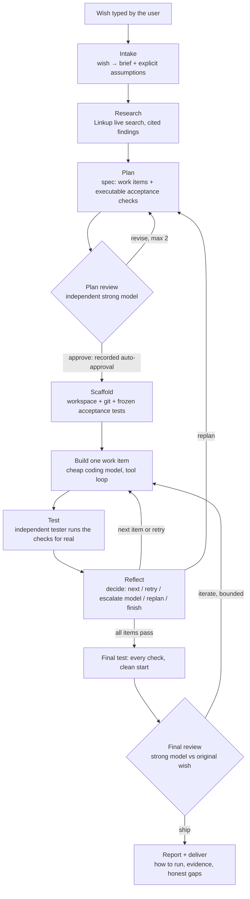
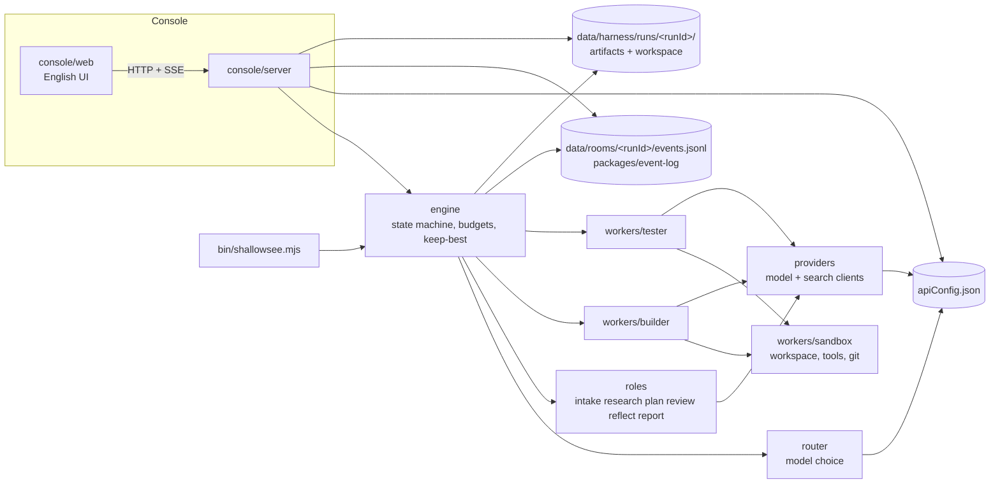

# ShallowSee Autopilot — architecture

Status: frozen contract for the nine parallel workstreams (Sun 15 Nov 2026, 00:00). Owner: PM session (bill-command). Change requests go through the hand-back report, see [../AGENTS.md](../AGENTS.md).

## 1. One run, end to end

A **run** turns one wish into one delivered product. It is fully automatic: after the wish is submitted, nothing asks the person for permission, data or direction. Everything the harness assumes is written down as an explicit, reviewable assumption instead of a question.



The engine owns this state machine. Every arrow is code, not a model decision, except where a role returns a **label** (approve or revise, next or retry, ship or iterate) that the engine validates against hard rules first. For example, if every check passes the run moves on whatever the reflector says, and if the budget is spent the run stops whatever any model says.

### Phases

| Phase | Role (module) | Default model tier | Output artifact |
|---|---|---|---|
| `intake` | intake (`roles/`) | 2 | `brief.json` |
| `research` | researcher (`roles/`) + Linkup | 2 | `research.json` |
| `plan` | planner (`roles/`) | 3 | `spec.json` |
| `plan_review` | reviewer (`roles/`) | 3, not the planner's model if another tier-3 model exists | `plan-review.json` |
| `scaffold` | engine + tester (`workers/tester` materialises acceptance tests) | 2 | workspace commit `scaffold` |
| `build` | builder (`workers/builder`) | 1 for easy, 2 for medium or hard, +1 tier per failed attempt | git commit per attempt |
| `test` | tester (`workers/tester`) | 2, never the builder's model, different vendor when possible | `tests/NNN.json` |
| `reflect` | reflector (`roles/`) | 2, 3 after repeated failures | `reflections/NNN.json`, `progress.md` |
| `final_test` | tester | 2 | `tests/final.json` |
| `final_review` | reviewer | 3 | `final-review.json` |
| `report` | reporter (`roles/`) | 2 | `REPORT.md` |

Tiers: 1 = cheap and fast (for example Haiku 5.5), 2 = balanced (Sonnet 5.5), 3 = strongest (Opus 5.5, Fable 5.2). The router maps tiers to whatever models the user has configured; see `router/`.

### Hard limits (code-enforced)

- `budget.maxUsdPerRun`, `budget.maxMinutesPerRun`, `budget.maxBuildIterations` from `apiConfig.json`, overridable per run.
- Plan revisions: at most 2. Attempts per work item: at most 3 (attempt 2 escalates one tier, attempt 3 escalates to tier 3). Final-review iterations: at most 1.
- When a limit is hit the run stops building and goes straight to `final_test` → `report` with status `partial`. The report says plainly what does not work.

### Never regress (keep-best)

After every test the engine compares the score (passed checks ÷ total checks in scope, plus regression checks of items already done) with the best so far. If the new candidate scores lower, the engine resets the workspace to the best commit before the next attempt. The delivered product is always the best-scoring commit.

### Autonomy setting

`routing.autonomy` in `apiConfig.json`:
- `"full"` (default): the plan-review verdict is the approval. It is recorded as `{ by: "model", model: "<ref>", at }` and the UI shows it as **"Auto-approved by <model>"**. It is never labelled as a user confirmation.
- `"confirm_plan"`: after plan review the run pauses in phase `awaiting_confirmation` until `POST /api/runs/:id/confirm`. This exists for teammates who keep the WISH-CODING human gate; the demo uses `"full"`.

## 2. Components



- **Brain, hands and session are separate.** The engine (brain) never touches files directly; the sandbox (hands) never holds keys; the event log plus run folder (session) is the durable record, so the UI can replay any run and a crashed engine leaves an honest trail.
- **Roles never call each other.** The engine calls a role with exactly the context it needs (artifacts by reference, not chat transcripts) and gets back one validated JSON artifact.
- **One tool interface.** Builder and tester reach the workspace only through `executeTool(workspace, name, input) → string`.
- **Permissions in code.** Only intake, researcher and planner receive a `search` function. The builder and tester get none. Search is a capability passed in, not a prompt instruction.

## 3. Data on disk

```
apiConfig.json                         # keys, never committed (template: apiConfig.example.json)
data/rooms/<runId>/events.jsonl        # v1 event envelope, via packages/event-log (append-only)
data/harness/runs/<runId>/
  state.json                           # current phase, counters, best candidate, spend
  wish.txt  brief.json  research.json  spec.json  plan-review.json
  progress.md                          # structured notes, appended after every reflection
  tests/001.json ... tests/final.json
  reflections/001.json ...
  final-review.json  REPORT.md
  workspace/                           # the product being built: its own git repository
    acceptance/                        # frozen acceptance tests (builder must not edit; tamper-checked)
```

Formats: [../contracts/artifacts.md](../contracts/artifacts.md). Events: [../contracts/events.md](../contracts/events.md).

## 4. What the products can be (scope for the demo)

To keep testing real and fast, the planner must choose one stack:
- `static-web`: HTML, CSS and JavaScript files opened in a browser and served by the console's preview route.
- `node`: Node.js 20+ scripts (`.mjs`) or a small HTTP server, built-in modules only.

Python is out of scope this sprint: Node's permission model gives model-run code a real file-system boundary (workspace only, no child processes), and there is no equivalent for Python here. See the "Sandbox boundary" table in [../contracts/interfaces.md](../contracts/interfaces.md) for exactly what is and is not guaranteed. No package installs. External web APIs are allowed in the product when they need no key (the research step finds them). This rules out some wishes, and the intake step says so in its assumptions rather than failing silently.

## 5. Model selection in one paragraph

The router reads the configured models (from `apiConfig.json`) and a built-in catalog of tiers, capabilities and prices. The planner runs on the **strongest** model provided, sees the list of configured models, and for each work item suggests which model should build it and why (team decision, room #247). That suggestion is advice: the router accepts it only if the model exists, has the needed capabilities, isn't excluded and fits the budget. For each call the engine asks `selectModel({ role, difficulty, attempt, needs, avoid, suggested })`. The policy encodes Bill's mapping (strong models plan and review, cheap models code, an independent model tests, a vision-capable model looks at images), escalates one tier after each failed attempt, keeps the tester off the builder's model, and prefers the cheapest model that satisfies the tier. Users can pin a model per role in the Setup page; a pin wins unless it lacks a required capability. Every choice is logged with a one-line reason the UI shows.
