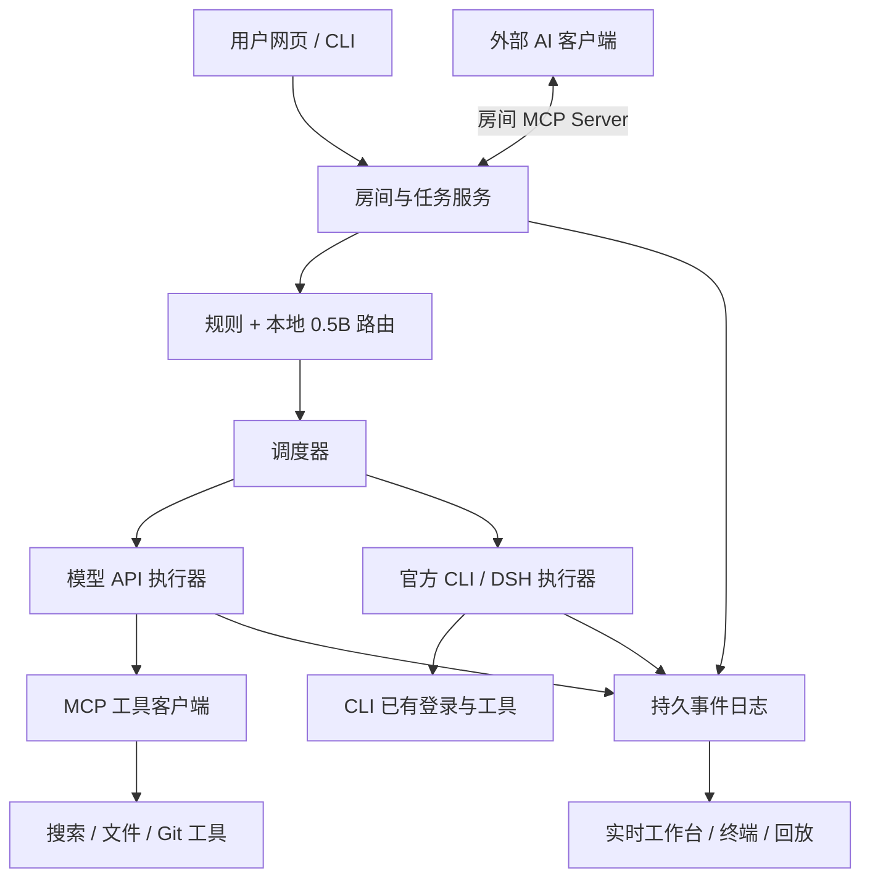

# ShallowSee Harness — architecture and three-person build plan

*Autonomous Agents track, Imperial AI Hack. Written 14 November 2026. 本文为结构设计与待开发计划，时间均采用 Europe/London。格式参考仓库中的 Fable 方案，团队执行以共同确认的接口与里程碑为准。*

## Outline

**一句话定位**

一个多模型协作工作台，让 API 模型、使用订阅登录的官方 CLI 和外部 MCP 客户端共享任务与信息，由本地 0.5B 模型协助决定消息交给谁、何时启动下一位成员。

**用户问题**

开发者已有多个 AI 账户，却需要在窗口间复制资料、解释上下文、交接任务和核对结果。多人或多模型协作时，重复讨论、遗漏信息和执行成本难以追踪。

**用户看到的完整流程**

1. 输入目标、验收条件和执行限制，创建协作房间。
2. 选择研究、实现、评审等角色，为每个角色配置模型与运行方式。
3. 成员通过共享房间交换消息，调度器按任务依赖安排执行。
4. 本地小模型处理需要语义判断的消息，提出投递与唤醒建议。
5. 网页和终端实时展示发言、公开进度、工具活动和结果。
6. 任务产出文件、补丁或报告，附上可检查的验证证据。
7. 完整过程进入事件日志，支持恢复、回放和成本评测。

**首版规模**

一个本地服务、三个逻辑角色、至少一家模型 API 和一种官方 CLI、一种 MCP 客户端接入、一个完整演示场景。供应商列表通过适配器扩展。默认角色为 Researcher、Builder、Reviewer，角色与供应商分别配置。

**技术方向**

拟采用 TypeScript 协调服务、HTTP 命令接口、SSE 实时事件和本地事件存储。Qwen2.5-0.5B-Instruct 可通过独立的本机推理服务接入。DeepSeek Harness 先作为可替换执行后端，后续可封装 Cordis 插件。选择独立协调层，是为了让不同 CLI、API 和 MCP 客户端使用相同房间协议。[DeepSeek Harness 架构](https://github.com/deepseek-ai/deepseek-harness/blob/39163dd30f703a79079e2d2446545cff3c453738/docs/architecture.md) · [Qwen 官方量化模型](https://huggingface.co/Qwen/Qwen2.5-0.5B-Instruct-GGUF)

**比赛对齐**

Autonomous Agents 强调可靠完成实际多步骤任务。评分权重为运行效果 30%、技术深度 25%、实用性 20%、视频与答辩 15%、原创性 10%。提交截止为 2026 年 11 月 15 日 12:00，提交物包括最长两分钟视频与公开仓库，视频和最后一次提交均须早于截止。本文按该规则更新 Fable 原文中的演示安排。[官方赛页](https://imperial-ai-hackathon.devpost.com/) · [官方规则](https://imperial-ai-hackathon.devpost.com/rules)

## Architecture

### API、订阅 CLI 与 MCP

| 接入 | 承担的工作 | 认证与能力边界 |
| --- | --- | --- |
| 模型 API | 推理、流式回答、支持时的工具请求 | 用户配置 API key，各供应商协议独立适配 |
| 官方 CLI | 使用现有 Agent 的执行环境、工具和会话能力 | 使用官方登录流程，具体套餐权益与自动化支持按账户核实 |
| 房间 MCP Server | 让外部 AI 加入房间、读写消息、领取任务和发布进度 | MCP 客户端决定何时调用工具，成员身份记录来源 |
| MCP 工具客户端 | 给 ShallowSee 的 API Agent 提供外部工具 | 工具能力、访问范围、调用结果进入执行记录 |

Token Plan 在本设计中指通过官方产品提供的套餐或订阅权益使用模型。模型 API 额度和产品订阅分别配置。MCP 连接提供工具访问，自动启动或恢复一个停止的客户端需要额外的官方 CLI／运行接口。

API Agent 的完整执行循环包括模型请求工具、程序执行工具、把结果返回模型、继续生成。文本流式接口只是其中一部分。每种后端要记录它实际支持的工具、取消、恢复、用量和输出粒度。

### 成员与任务

| 对象 | 关键字段 | 用途 |
| --- | --- | --- |
| Room | roomId、goal、acceptanceCriteria、status、limits | 定义共同目标与执行范围 |
| Member | memberId、role、providerId、mode、capabilities、provenance | 分离逻辑身份、供应商与运行方式 |
| Task | taskId、owner、dependencies、inputs、deliverables、acceptance、status、version | 记录工作归属、前置条件和验收 |
| Message | messageId、roomId、taskId、author、recipients、kind、replyTo、content | 支持定向交接和线程关系 |
| Artifact | artifactId、taskId、location、version、evidence | 指向文件、补丁、报告或测试结果 |
| Run | runId、taskId、memberId、provider、model、state、usage、timestamps | 记录一次实际执行 |

托管成员由 ShallowSee 通过 API 或 CLI 启动。外部成员在自己的客户端中运行，通过 MCP 领取待办和交付。配置身份、供应商报告身份和客户端自报身份分别标记。

任务状态拟采用 pending、ready、running、blocked、review、done、failed、cancelled。进入 done 需要满足任务的验收条件，验收方式可以是测试结果、证据检查或用户确认。首版编码场景安排一个写入者，其余成员负责研究与评审。

### 0.5B 路由与调度

小模型输入为短目标摘要、新消息、任务依赖、候选成员职责与状态。输出使用固定字段和允许的成员 ID。

| 输出字段 | 语义 |
| --- | --- |
| deliverTo | 哪些成员需要接收这条信息 |
| wake | 哪些成员现在需要执行，是 deliverTo 的子集 |
| reasonCode | 简短路由类别，例如 review_required、revision_requested |
| escalate | 是否需要主持 Agent 进一步判断 |
| source | rules、local_model 或 fallback |

明确提及的成员、工具失败归属和确定的任务依赖使用规则处理。小模型负责语义相关性判断。结构化输出需要验证成员、字段和关系，模型自报 confidence 不能直接当作可靠概率。

程序负责最终执行检查，包括房间状态、依赖、并发上限、次数／时间／预算和重复触发。预算字段先区分可精确计量、估算和未知。供应商没有返回用量时保留未知。

正在执行的成员接收新消息后先入队。消息使用唯一 ID，任务执行使用租约或等效的原子领取机制。暂停时增加房间执行版本，旧路由结果和旧执行回调只能更新对应历史，不能恢复已经取消的调度。

房间完整保存历史。每个成员的上下文由任务输入、相关增量、产物引用和当前触发消息组成。触发消息始终保留。原文可按需读取，避免短摘要遗漏导致证据永久丢失。

### 实时交流与事件日志

网页参考现有协作会议的时间顺序，显示作者、角色、模型、来源、时间和内容。执行中的回答按 runId 合并，正式结果与同次执行关联。

| 事件族 | 展示内容 |
| --- | --- |
| room / member | 房间和成员状态变化 |
| task | 分配、依赖变化、验收与终态 |
| message | 用户和 Agent 的正式发言 |
| route | 投递对象、唤醒对象和简短原因 |
| run | 开始、结束、失败与取消 |
| progress | Agent 主动发布的简短执行进度 |
| summary | 供应商公开提供的简短推理摘要 |
| output | 流式回答片段 |
| tool | 工具名称、状态和结果摘要 |
| artifact / usage | 产物、验证证据和可取得的用量 |

实时“思考”区域展示公开进度、可用推理摘要和工具活动。原始私有思维字段不属于事件协议。供应商仅支持整段输出时，界面按实际接收粒度展示。

每个事件包含 eventId、roomId、type、timestamp、payload、schemaVersion。涉及具体任务或执行时附 taskId、runId，房间和成员事件可以省略。事件先持久化再广播，订阅方通过游标恢复并去重。实时界面与历史回放读取同一日志，回放明确显示为已保存记录。

## Interfaces

以下为拟议接口，供三人协商后冻结。

| 接口 | 输入 | 输出 | 主要调用者 |
| --- | --- | --- | --- |
| Provider.run | 角色、目标、相关上下文、工具能力、取消信号 | 统一流式执行事件 | 调度器 |
| Router.route | 触发事件、房间／任务摘要、候选成员 | RouteDecision | 调度器 |
| Scheduler.dispatch | 已验证路由结果、任务版本、执行限制 | 排队／启动／拒绝原因 | 房间服务 |
| EventStore.append | 事件数据 | 已持久化的事件与游标 | 房间与执行器 |
| EventStore.read | roomId、afterEventId | 增量事件 | 工作台、MCP、回放 |
| ArtifactStore.register | 产物位置、版本、验证证据 | artifactId | 执行器 |

MCP Server 首版工具拟包括 room_create、room_list、room_join、room_read、room_post、task_claim、task_update、progress_report、agent_wake 和 room_pause。参数复用业务契约，返回事件 ID 和业务对象。领取任务要避免重复执行，进度上报只记录事实。

HTTP 用于网页与 CLI 的命令调用，SSE 用于单向实时输出。MCP stdio 服务连接同一个协调进程，业务日志与协议输出使用独立通道。后续接入远程 MCP 时再补对应认证与传输配置。

凭据由服务环境或官方 CLI 管理。房间记录与网页仅获得必要元数据。共享契约的字段调整需要同步另外两人，新增可选字段优先，破坏性修改增加协议版本。

## Three owners

| 负责人 | 模块范围 | 需要交付 | 与队友的边界 |
| --- | --- | --- | --- |
| A · Runtime and integrations | 房间、任务、调度、API／CLI、MCP、日志存储 | 两种后端真实交接，工具调用与失败状态可追踪 | 向 B 提供 Router 输入，向 C 提供 HTTP/SSE |
| B · Routing and evaluation | 本地 0.5B、规则回退、上下文选择、路由评测 | 可切换路由器、标注样本、对照结果 | 使用共享契约，独立维护路由逻辑 |
| C · Workbench and demonstration | 网页、终端、实时消息、回放、演示与验收材料 | 可看懂的任务全过程、产物检查和两分钟视频 | 消费事件与业务接口 |

拟议目录对应 packages/contracts、packages/core、packages/providers、packages/router、apps/server、apps/mcp、apps/web、apps/cli。成员姓名与具体供应商在首次设计会确定。

首个集成点是用户消息 → 路由 → 单次执行 → 实时结果 → 下一角色接力。第二个集成点增加任务依赖、工具证据和验收。A、B、C 每个里程碑一起检查接口与实际结果。

## Plan

以下阶段采用从重新启动开发开始计算的相对时间，属于建议排期。团队根据剩余时间压缩范围，目标在周日 11:00 前准备好提交，正式截止为 12:00。

### Hours 0–1 — freeze the design

- [ ] 三人确认角色、接入方式和唯一演示任务。
- [ ] 冻结 Member、Task、Message、RouteDecision、RunEvent 的最小字段。
- [ ] 确认两种执行后端的登录、工具、取消和输出能力。
- [ ] 为演示任务定义可核验的完成条件。

**Gate** — 三人能用同一组样例描述一次交接、一次报错和一次完成验收。

### Hours 1–3 — one task end to end

- [ ] A 接通房间、规则调度和两种执行后端。
- [ ] B 整理路由样本并跑通本地模型服务。
- [ ] C 使用共享事件样例完成工作台，再替换为真实事件。
- [ ] 一次任务从输入推进到可检查的产物。

**Gate** — 一次真实执行可在日志、网页和最终产物之间相互核对。

### Hours 3–5 — selective wake-up and MCP

- [ ] A 接通 MCP 加入、增量读取、发言和任务领取。
- [ ] B 接入本地模型路由与规则回退。
- [ ] C 展示投递、唤醒、等待、工具活动和公开摘要。
- [ ] 检查重复消息、暂停、超时和上下文遗漏。

**Gate** — 只有需要响应的托管成员启动执行，外部成员可以经 MCP 完成交接。

### Hours 5–7 — evidence and reliability

- [ ] 固定同一批任务、执行模型、预算和验收方式。
- [ ] 比较规则调度与 0.5B 调度，记录成功率、调用数、耗时和可取得的费用。
- [ ] 记录错唤醒、漏唤醒、回退率和本地路由延迟。
- [ ] 检查服务重启、订阅重连和已保存运行回放。
- [ ] 准备约 50 条人工检查的路由事件与 5 个小型完整任务，按时间调整数量并报告实际样本数。

**Gate** — 展示数字可追溯到运行日志，任务质量与节省开销一起报告。

### Final preparation — demonstrate and submit

- [ ] 按两分钟限制录制一个完整真实运行，加速片段标注倍速及真实耗时。
- [ ] 准备离线回放和最终产物，清楚标记回放与脚本演示。
- [ ] 整理公开仓库、依赖说明、启动方法、实际完成项和局限。
- [ ] 三人分别演练架构、路由评测和用户价值的答辩。
- [ ] 核对提交视频和最后一次 commit 都早于正式截止。

**Gate** — 新成员可按说明复现一次运行，评委可检查交付物和运行证据。

## Demonstration scenario

推荐先在一个小项目中完成 CSV 导出或修复一个有测试覆盖的问题，展示研究、实现、验证和定向修订。最终场景由团队确认。

Fable 的 Shelf Life 可作为另一个候选场景。研究成员提取易过期陈述并检索来源，实现成员生成修订，评审成员核对证据与修改。相互转载的页面不能当作独立证据，来源冲突需要标记不确定性。自动 PR、Linkup 与 Databricks 作为具体场景集成单独排期。

本轮吸收 Fable 的统一日志、完整任务验证、真实指标与备用回放建议。合作伙伴工具需要在实际任务中承担明确功能，bounty 选择在集成验证后确定。

## The pitch

| Beat | Time | What happens |
| --- | --- | --- |
| 用户问题 | 15 s | 展示开发者需要在多个 AI 间手动交接的具体工作 |
| 完整任务 | 75 s | 输入目标、成员执行、工具结果、一次定向修订和最终产物 |
| 实现方式 | 20 s | 房间、API／CLI、MCP、本地路由与事件流，展示实际使用的组件 |
| 差异与证据 | 10 s | 对照最接近产品，报告实际成功率与调度测量结果 |

合计 120 秒。视频标明人工、脚本与自动执行的部分。首轮使用视频与答辩，晋级后准备现场运行。[官方演示要求](https://imperial-ai-hackathon.devpost.com/)

## If you fall behind

按以下顺序缩减范围。

1. 延后更多供应商适配和额外 bounty，先保留已验证的两种后端。
2. 延后自动 PR 和复杂仪表盘，交付可检查的本地补丁、报告或来源表。
3. 延后多写入者并发，使用单一写入者加独立评审。
4. 小模型效果不足时保留规则基线和实际对照结果，说明本地路由仍属实验功能。

优先保留完整任务、来源与执行证据、明确失败状态、可核验指标和两分钟演示。

## Risks and fallbacks

| 风险 | 对应方案 |
| --- | --- |
| 0.5B 选择错误成员或漏发消息 | 缩小候选集，校验结构，保留规则回退和人工指定对象 |
| 暂停后旧路由结果返回 | 使用房间执行版本，拒绝过期调度 |
| 重复消息触发重复工具操作 | 消息幂等键、原子任务领取、副作用完成记录 |
| 某家套餐无法用于拟议自动化方式 | 核实官方支持路径，选择已验证的 CLI 或独立 API 配置 |
| CLI 不提供连续 token 或精确用量 | 显示实际输出粒度，用量标为未知 |
| MCP 客户端关闭后不能被动接收唤醒 | 由受支持的托管执行器启动，或保留待办供客户端下次领取 |
| 服务中断、日志尾部写入不完整 | 标记在途任务中断，保留原日志并验证恢复，避免盲目重跑副作用 |
| 模型交互循环没有进展 | 设置次数、时间和预算限制，通过任务验收与停滞检测结束或升级 |
| 现场网络不稳定 | 使用明确标记的已保存运行与录像，同时保留真实运行证据 |

## Decisions to confirm together

- [ ] 三个人的实际负责人姓名和模块归属。
- [ ] 首个演示采用代码任务还是 Shelf Life。
- [ ] 两个优先验证的实际执行后端和一个 MCP 客户端。
- [ ] 本地推理机器、运行预算与账户支持范围。
- [ ] 首版共享契约与验收条件。

以上均为设计讨论事项。实际性能、兼容性和额度在开发验证后记录。
